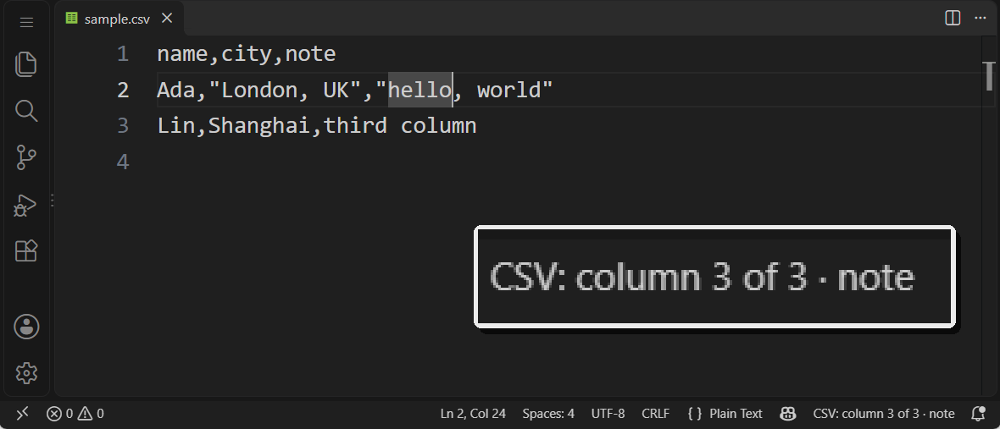
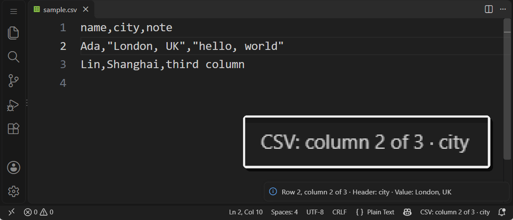

# NoColorCSV

[English](README.md) · [简体中文](README.zh-CN.md) · [日本語](README.ja.md) · [한국어](README.ko.md) · [Español](README.es.md)

NoColorCSV es una extensión de VS Code para personas con dificultades de percepción del color y para quienes no pueden distinguir fácilmente las columnas mediante colores. Muestra el número de columna, el encabezado y una vista previa del contenido de la celda, y permite navegar con el teclado.

## Así se ve en VS Code

Estas capturas muestran la barra de estado de v0.1.3 con el [archivo de ejemplo](examples/sample.csv). La barra actual también muestra la fila lógica; las capturas nuevas están pendientes.

**Columna actual:** Al situar el cursor en `hello, world`, la barra de estado indica la columna 3 y su encabezado `note`.



**Detalles de la celda:** Con el cursor en `London, UK`, al seleccionar el elemento de la barra de estado se muestran en texto la fila, la columna, el encabezado y el valor de la celda. La coma dentro del campo entre comillas no inicia otra columna.



## Diferencias con Rainbow CSV

[Rainbow CSV](https://github.com/mechatroner/vscode_rainbow_csv) resalta las columnas con colores distintos y también ofrece información en la barra de estado y al pasar el cursor, alineación y consultas. NoColorCSV se centra en la lectura de archivos CSV sin depender de la distinción entre colores.

| | NoColorCSV | Rainbow CSV |
| --- | --- | --- |
| Identificación de columnas | Número de columna, encabezado y vista previa de la celda en texto | Resaltado por color e información en la barra de estado y al pasar el cursor |
| Navegación con teclado | Desplazamiento entre columnas y por la misma columna en otras filas | Seguimiento de columnas y edición con varios cursores |
| Formatos | Archivos `.csv` separados por comas | CSV, TSV y otros formatos delimitados |
| Herramientas de datos | Lectura y ubicación de celdas | Alineación, CSVLint y consultas RBQL |

NoColorCSV no modifica el contenido del CSV ni añade colores a las columnas.

## Instalación

Descarga el archivo `.vsix` de la [versión más reciente](https://github.com/EETKILLER/NoColorCSV/releases/latest). En VS Code, abre **Extensiones**, selecciona `…` → **Instalar desde VSIX...** y elige el archivo descargado.

## Uso

Abre un archivo `.csv` y mueve el cursor. La barra de estado muestra la fila lógica, la columna actual, el total de columnas de esa fila y el encabezado disponible. También indica las celdas vacías y los encabezados ausentes. La celda actual no vacía lleva un subrayado continuo y una marca lateral; las celdas visibles no vacías de la misma columna llevan un subrayado discontinuo y otra marca. Las celdas vacías solo muestran la marca lateral. Selecciona el elemento de la barra de estado para ver los detalles en texto, o usa la paleta de comandos.

| Comando | Windows / Linux | macOS |
| --- | --- | --- |
| NoColorCSV: Mostrar columna actual | — | — |
| NoColorCSV: Ir a la columna siguiente | Ctrl+Alt+Shift+→ | Cmd+Alt+Shift+→ |
| NoColorCSV: Ir a la columna anterior | Ctrl+Alt+Shift+← | Cmd+Alt+Shift+← |
| NoColorCSV: Ir a la siguiente fila de la misma columna | Ctrl+Alt+Shift+↓ | Cmd+Alt+Shift+↓ |
| NoColorCSV: Ir a la fila anterior de la misma columna | Ctrl+Alt+Shift+↑ | Cmd+Alt+Shift+↑ |

Puedes cambiar los atajos buscando `NoColorCSV` en **Métodos abreviados de teclado** de VS Code. Al moverse entre filas, se omiten las que no contienen la columna de destino.

La opción `nocolorcsv.hasHeader` utiliza el primer registro del CSV como encabezados de forma predeterminada. Desactívala para archivos sin encabezados. La numeración de filas siempre comienza en el primer registro.

`nocolorcsv.columnFocus` usa `column` de forma predeterminada. Con `cell` solo marca la celda actual y con `off` elimina las marcas. `nocolorcsv.statusBar` usa `true` de forma predeterminada; desactívala para ocultar el elemento de la barra. El comando **Mostrar columna actual** y la navegación por teclado siguen funcionando con cualquiera de las dos opciones de visualización desactivada. Un archivo vacío conserva una posición para el cursor; un salto de línea final no añade una fila lógica.

`nocolorcsv.columnSymbols` está desactivado por defecto. Al activarlo, el borde de la celda actual y la barra de estado muestran el número de columna, empezando por 1, junto a un símbolo repetido. Los ocho símbolos se repiten: las columnas 1 y 9 comparten forma, pero conservan números distintos. Las demás celdas de la columna mantienen marcas compactas. Si la fuente no muestra un símbolo, usa el número de columna en la barra o en **Mostrar columna actual**.

`nocolorcsv.accessibilityPreset` ofrece `standard` (aspecto de v0.2), `highContrast` (bordes de foco más fuertes, símbolos e indicación textual) y `screenReader` (sin marcas ni símbolos por defecto; fila, columna, encabezado y valor siguen disponibles en texto). Solo cambia la presentación de esta extensión. Los valores explícitos de `columnFocus`, `statusBar` o `columnSymbols` tienen prioridad sobre el ajuste predefinido. Para recuperar sus valores por defecto, elimina el ajuste individual de la configuración de usuario o del área de trabajo.

El analizador admite campos entre comillas, comas y saltos de línea dentro de esos campos, comillas dobles escapadas y BOM UTF-8. El separador es la coma ASCII `,`; la coma de ancho completo `，` se trata como texto.

## Desarrollo

Se requieren [Visual Studio Code](https://code.visualstudio.com/) y Node.js 24.

```sh
npm ci
npm test
```

Abre el repositorio en VS Code y pulsa **F5** para iniciar el entorno de desarrollo de extensiones. La configuración compila TypeScript antes de iniciar. Abre `examples/sample.csv`, mueve el cursor por una coma entre comillas y entre filas, y comprueba las marcas y la fila lógica. Cambia `nocolorcsv.columnFocus` entre `column`, `cell` y `off`; desactiva `nocolorcsv.statusBar` y ejecuta **Mostrar columna actual**. Comprueba también una celda vacía, un campo entre comillas con varias líneas, el desplazamiento y el cambio a un archivo que no sea CSV. Prueba un zoom alto y un tema de alto contraste. Estas acciones no deben modificar ni guardar el CSV.

Para verificar v0.3, crea un CSV temporal con al menos 20 columnas y compara las columnas 1, 9 y 17: el símbolo se repite, pero el número las distingue. Cambia los símbolos y los tres ajustes predefinidos; desactiva explícitamente `columnSymbols` con `highContrast`. Comprueba un editor estrecho, ajuste de línea, zoom al 200 %, temas claro/oscuro/de alto contraste y la lectura de la barra y **Mostrar columna actual** con un lector de pantalla. Comprueba la navegación por teclado en Windows, macOS y Linux cuando estén disponibles. Al cerrar el CSV o cambiar a otra pestaña deben desaparecer las marcas. Compara el contenido del archivo antes y después: la extensión no debe editarlo.

Para crear un VSIX instalable:

```sh
npm run package
```

Consulta [AGENTS.md](AGENTS.md) para las convenciones de desarrollo y [LICENSE](LICENSE) para los términos de licencia.

## Desarrollo asistido por IA

EETKILLER desarrolla y mantiene NoColorCSV con la ayuda de OpenAI Codex para la programación.
